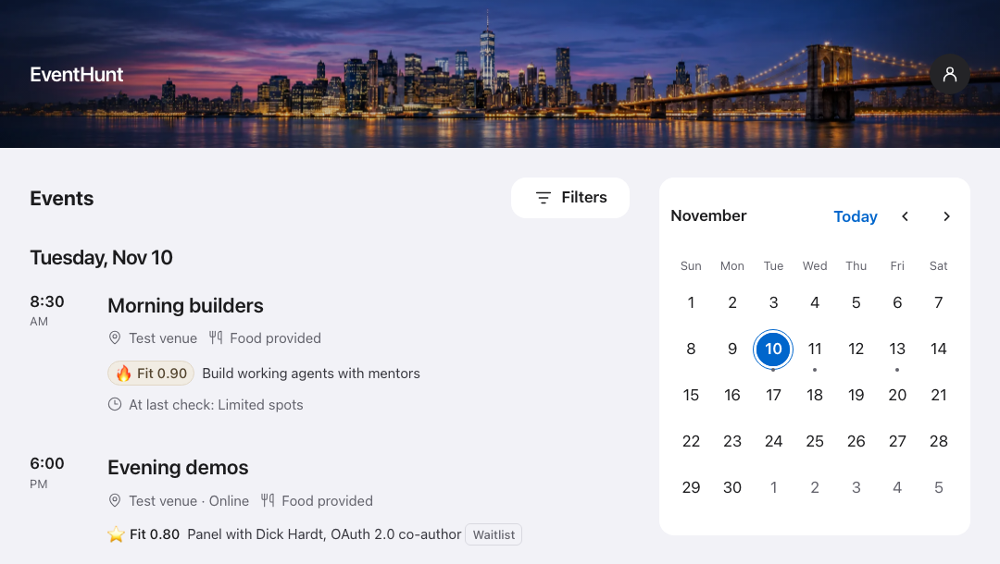
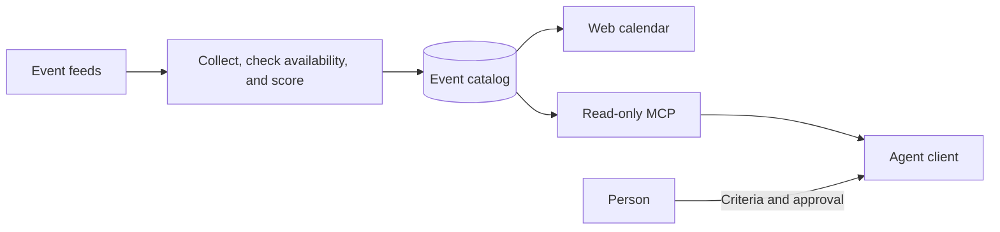

# Event Hunt

**Find your next AI, tech, or startup event.**

Browse events from Luma, Eventbrite, Meetup, and Partiful in one calendar.
See what stands out, spot waitlists, and go straight to the organizer.

[Browse events](https://eventhunt.net) · [Work with your agent](#agent-workflow) · [Run locally](#quick-start)

## Screenshot

## Agent workflow

Ask your agent to find a free AI workshop next week. It pulls a shortlist
from Event Hunt and checks the time, price, and registration status on
the organizers’ pages. You can also send it a listing from the calendar.

You choose what to attend and which actions the agent can take. With the
access you grant, the agent registers, checks the organizer’s reply, and
adds confirmed events to your calendar. It brings a waitlist or a change
in plans back to you.

For recurring scouting, approve registration rules in advance. A weekly
scout finds and requests spots. A daily follow-up checks organizer replies
and adds confirmed events to your calendar. The agent brings exceptions
to you. [Agent setup and scheduled prompts](doc/development/mcp.md)

## System overview

The worker saves listing details, availability, and fit scores in SQLite
or PostgreSQL. The Starlette app serves the calendar and the authenticated
`find_events` tool. Your agent handles registrations and follow-up through
its own authorized browser, mail, and calendar tools.
[System architecture](doc/development/architecture.md#system-overview)

## Quick Start

[Run the local demo](doc/development/web.md#run-the-demo) with sample events
or [configure feeds](doc/administration/operations.md#source-feeds) for the
communities you follow.

[Contributing](CONTRIBUTING.md) · [MIT license](LICENSE) · [Icon license](web/discovery/icons/LICENSE)
